# Architecture — Advanced Alpha Generation Engine

## Overview

The Advanced Alpha Generation Engine is a deterministic, point-in-time (PIT) quantitative research library and evaluation framework for causal cross-sectional and time-series alpha signals. It enforces strict separation between external data/legacy adapters, core feature and baseline computation, walk-forward out-of-sample evaluation, cost-aware position research, and gated alpha catalog promotion.

> [!IMPORTANT]
> This engine is strictly a research and paper-signal evaluation platform (`execution_enabled: false`, `execution_mode: paper_only`). It makes no promise of predictive edge or profitable live execution.

## System Architecture

```mermaid
flowchart LR
    subgraph External["External & Legacy Boundaries"]
        FIX["Synthetic / Permitted PIT Fixtures<br/>(Parquet + SHA-256 Manifest)"]
        LEG["Clean-Room Legacy Adapters<br/>(StatArb, Pairs, OrderBook, ResearchAgent)"]
    end

    subgraph M1["M1: Domain Contracts & PIT Validation"]
        LOAD["PointInTimeDataLoader<br/>(Checksum + as_of_utc Filter)"]
        VAL["PointInTimeValidator<br/>(UTC Causality, Splits, Survivorship, Coverage)"]
    end

    subgraph M2["M2: Factors & Predictive Baselines"]
        FAC["Versioned Factor Library<br/>(Momentum, Reversal, Volatility, PIT Fundamentals)"]
        FMAT["FeatureMatrixBuilder<br/>(Aligned Causal Features)"]
        MOD["Statistical & ML Baselines<br/>(EqualComposite, Ridge, GBDT, Isolated XGBoost)"]
    end

    subgraph M3["M3: Evaluation, Neutralization & Costs"]
        NEUT["SignalNeutralizer<br/>(Winsorize, Sector/Beta/Vol Neutral, Z-Score)"]
        WF["WalkForwardEvaluator<br/>(Chronological Splits + Purge/Embargo)"]
        COST["SignalToPositionResearcher<br/>(Capped Weights, Smoothing, Spread + Impact Grid)"]
    end

    subgraph M4["M4: Versioned Catalog & Paper Export"]
        CAT["AlphaCatalog<br/>(Append-Only trials.jsonl, BH FDR, Duplication & Gate Enforcement)"]
        EXP["PaperSignalExporter<br/>(SHA-256 Digest, execution_enabled=false)"]
        OBS["EngineMetricsRecorder<br/>(Health, Failure & Decision Metrics)"]
    end

    FIX --> LOAD --> VAL
    VAL --> FAC
    VAL --> LEG
    FAC --> FMAT --> MOD
    FAC --> NEUT
    LEG --> NEUT
    MOD --> WF
    NEUT --> WF
    WF --> COST
    WF --> CAT
    COST --> CAT
    CAT --> EXP
    WF -.-> OBS
    CAT -.-> OBS
    EXP -.-> OBS
```

## Component Boundaries

| Component / Module | Package Path | Responsibility and Boundary |
|---|---|---|
| Domain contracts & PIT validation | `src/alpha_engine/contracts/`, `src/alpha_engine/data/` | Owns canonical UTC schemas, checksum-verified loading, corporate-action integrity, survivorship enforcement, and causality checks. |
| Factor definitions & feature interface | `src/alpha_engine/factors/` | Computes deterministic, versioned causal factors with explicit `event_ts_utc` and `available_at_utc` timestamps. |
| Clean-room legacy adapters | `src/alpha_engine/adapters/` | Isolates external/legacy prototype interfaces (`Quantum-Trading`, `Trading-Software`) behind canonical signal contracts with explicit IP provenance. |
| Statistical & ML baselines | `src/alpha_engine/models/` | Implements deterministic cross-sectional baselines (`EqualRankCompositeBaseline`, `RidgeAlphaBaseline`, `GradientBoostedAlphaBaseline`) and isolates optional `XGBoostAlphaBaseline`. |
| Signal evaluation & neutralization | `src/alpha_engine/evaluation/` | Cross-sectional winsorization and risk neutralization, chronological walk-forward splitting with purge/embargo, IC/ICIR/bootstrap uncertainty, stability diagnostics, and factor duplication detection. |
| Cost-aware signal-to-position research | `src/alpha_engine/evaluation/costs.py` | Dollar-neutral capped weights, turnover smoothing, no-trade buffer, delisting liquidation accounting, and linear spread + convex impact sensitivity sweeps. |
| Versioned alpha catalog & paper exporter | `src/alpha_engine/catalog/` | Append-only trial ledger (`trials.jsonl`), Benjamini-Hochberg multiple-testing adjustment, non-bypassable promotion gates, approval metadata enforcement, and paper-only export with `ExecutionDisabledError` guard. |
| Observability | `src/alpha_engine/observability.py` | Captures structured stage timings, counters, promotion/rejection decisions, and failure diagnostics. |

## Explicit List of Unsupported Features (MVP Scope)

The following capabilities are **intentionally excluded** from MVP scope:

1. **Live order routing or broker execution**: Hard-disabled in `EngineConfig` and `PaperSignalExporter`.
2. **Real-time tick / L2 order-book ingestion**: `QuantumOrderBookAdapter` operates on a documented daily OHLCV proxy; true L2 depth requires an approved market-data provider contract.
3. **Portfolio-level mean-variance / multi-strategy capital allocation**: Deferred to dependent plans (#12 Dynamic Capital Allocation / #17 Multi-Strategy PMS).
4. **Live market data vendor connectors**: Only deterministic synthetic fixtures or explicitly licensed, checksummed local PIT datasets are supported in MVP.
5. **Automated unreviewed model promotion**: Every promotion requires both passing validation gates and explicit `approver` + `approval_ticket` metadata.
6. **Distributed compute orchestration**: Implemented as a single-process Polars/NumPy pipeline; process boundaries are kept minimal until dataset scale justifies distribution.
