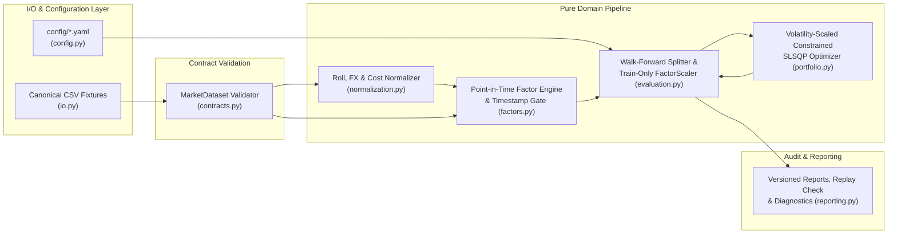

# Architecture Overview

## 1. System Boundary & Data Flow

The Cross-Asset Factor Investing Engine strictly separates I/O, data normalization, point-in-time factor construction, constrained portfolio optimization, walk-forward evaluation, and versioned reporting. Domain logic operates exclusively on typed, validated Polars DataFrames and NumPy arrays with zero hidden global state or filesystem side effects.

---

## 2. Module Responsibilities

| Module | Layer | Responsibility |
|---|---|---|
| `errors.py` | Core | Typed exception hierarchy with machine-readable `.code` and structured `.details` |
| `config.py` | Config | Frozen dataclasses, strict YAML validation, canonical SHA-256 `config_hash()` |
| `diagnostics.py` | Observability | Structured JSONL event stream and deterministic operational counters |
| `contracts.py` | Validation | Canonical Polars schemas, dataset fingerprinting, and invariant enforcement |
| `io.py` | Adapter | Isolated CSV/JSON reader/writer adapters; never imported by domain algorithms |
| `normalization.py` | Domain | Roll-adjusted local returns, currency conversion, FX forward carry, explicit roll & financing drags |
| `factors.py` | Domain | Momentum, carry, and defensive signals with strict `publication_ts <= as_of_ts` gating, `provenance_hash`, training-only `FactorScaler`, and blended signal builder |
| `portfolio.py` | Domain | Shrinkage covariance estimation, unconstrained vol targeting, exact split-variable SLSQP constrained optimizer, and `verify_portfolio_constraints()` |
| `evaluation.py` | Domain | Walk-forward folds with embargo, OOS simulation with execution lag, benchmarks (`benchmark_equal_weight`, `benchmark_inv_vol`), cost & asset-class attribution |
| `reporting.py` | Output | Deterministic `run_id`, runtime metadata capture, JSON/CSV artifact writer, `verify_replay_equivalence()` |
| `cli.py` | Interface | `cafe` CLI (`validate`, `run`, `verify-replay`) with non-zero exit codes on errors |

---

## 3. Core Invariants

1. **Zero Look-Ahead from Publication Lag:**
   - Every factor lookup filters strictly on `publication_ts <= as_of_ts(signal_date)`.
   - Every emitted signal stores `source_max_publication_ts` and passes `verify_signal_provenance()` asserting `source_max_publication_ts <= as_of_ts`.
2. **Training-Only Preprocessing:**
   - `FactorScaler` computes per-`(asset_class, factor_name)` mean and standard deviation exclusively on `[train_start, train_end]` of each walk-forward fold and applies those frozen parameters to `[test_start, test_end]`.
   - Covariance estimation uses strictly trailing returns up to the rebalance decision date.
   - An explicit `embargo_days >= 1` gap separates training and test windows, and `execution_lag_days >= 1` separates rebalance decision date from return accrual.
3. **Smooth Exact Constraint Enforcement:**
   - L1 gross exposure ($\sum_i |w_i|$), per-class gross exposure ($\sum_{i\in c}|w_i|$), and one-way turnover ($\frac{1}{2}\sum_i |w_i - w^{\text{prev}}_i|$) are formulated with non-negative split variables $w = w^+ - w^-$ and $\Delta w = \Delta^+ - \Delta^-$.
   - All linear exposure/turnover constraints and the convex quadratic volatility constraint ($w^\top \Sigma w \le \sigma_{\text{cap}}^2$) have exact analytical Jacobians.
   - Post-solve verification (`verify_portfolio_constraints`) raises `ConstraintViolationError` whenever strict mode is enabled and any constraint is infeasible or violated beyond `constraint_tolerance`.
4. **Deterministic Reproducibility:**
   - `run_id = <config_name>_<config_hash[:8]>_<dataset_hash[:8]>`.
   - Fixed seeds for synthetic fixture generation; zero stochasticity in the evaluation pipeline itself.

---

## 4. Key Trade-Offs & Limitations

- **Synthetic Data Scope:** All included datasets are deterministic synthetic research fixtures (`valid_small`, `synthetic_multi_year`). Measured Sharpe ratios, drawdowns, and turnovers reflect synthetic DGP properties, not live market alpha.
- **Carry Simplifications:** Equity carry models dividend yield minus local short rate and financing spread; FX carry models interest-rate differentials minus spread; commodity carry models log front-to-next roll yield minus annualized roll cost. Real-world repo specials, discrete dividend ex-dates, and seasonality curves are out of scope.
- **Transaction Cost Model:** Proportional one-way `tc_bps` plus explicit `roll_cost_bps` and daily `financing_spread_bps`. Nonlinear market impact (square-root impact / order-book liquidity) is excluded and delegated to execution research adapters (see `docs/integration.md`).
- **Offline Prototype Only:** Live capital, brokerage APIs, customer PII, and production credentials are strictly excluded.
