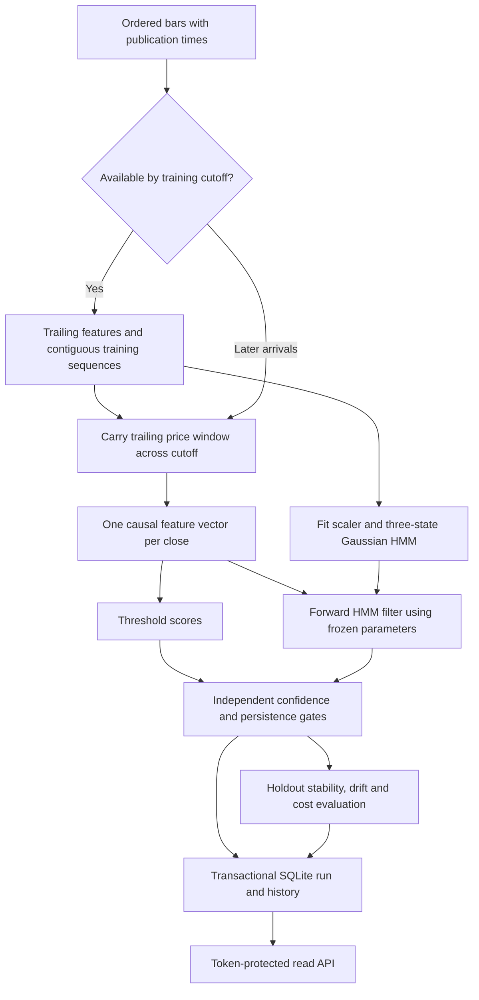

# Architecture and decisions

**Data and horizon.** The fixture represents one synthetic USD-denominated asset and a synthetic USD benchmark, quoted once per weekday. The default horizon is the current close, with at most one new decision per daily arrival. The model uses 15 trailing returns and a 252-session volatility convention. The demonstration marks the close available five minutes after its event. A future consumer can submit a bar only when it has arrived. All fields in a row share the latest field's availability. The integration boundary accepts immutable, point-in-time observations from an upstream adapter.

**Model choice.** The deterministic rule scores signed trend and stresses deviations above absolute volatility or spread thresholds. A three-state Gaussian HMM adds persistence through a learned transition matrix. The implementation standardizes features on eligible training rows and initializes clusters by volatility plus spread, then by trend. Batch Baum–Welch uses separate sequences across incomplete windows, diagonal emissions, a 0.05 standardized variance floor, 0.05 transition/start pseudocounts and a fixed iteration count. After fitting, the component with highest standardized volatility plus spread becomes stressed. The remaining pair is ordered by mean trend. Rising and falling are relative descriptions. The fitted components can overlap.

**Inference.** The trailing window carries across the training cutoff. The first held-out posterior starts from the fitted initial distribution. Each subsequent posterior uses the previous filtered posterior, the transition matrix and the current observation likelihoods. Backward messages exist only during training. The rule's normalized scores and HMM posterior indicate relative model preference. Their magnitudes have no empirical calibration against true regime labels.

**Publication and recovery.** The online interface consumes one bar at a time. The local replay driver collects a finite input, fits once, and publishes its completed holdout as one immutable SQLite transaction. This keeps concurrent readers on a complete history. Each run stores input and settings fingerprints, feature/engine versions, fitted parameters and the training boundary. Deterministic replay restores the rolling window, posterior and hysteresis counters from source. Bump the engine version when inference or report semantics change. Byte-identical model fingerprints require matching arithmetic runtimes.

**Dependencies and scope.** The standard library covers CSV, numeric inference, SQLite and HTTP. All project code and fixtures were created for this prototype. There are no provider SDKs, linked personal repositories, external models, broker connections or integration requirements on projects 17, 18 and 23. Those projects can integrate after agreement on schemas, availability times and ownership.

**Unsupported features.** Intraday ticks, revised or out-of-order bars, exchange holiday calendars, corporate-action adjustment, cross-currency series, portfolio aggregation, online retraining, per-event durable checkpoints, multi-host serving and order execution are outside this version. The evaluation uses a single synthetic path and cutoff. Overlapping windows reduce the effective sample size. A spread proxy cannot describe market depth, and diagonal emissions approximate dependent market features. Validate the asset class, licensing, horizon and thresholds before considering another dataset.
