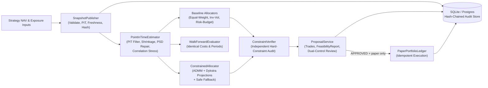

# Architecture & Component Boundaries

## 1. System Overview

The Dynamic Capital Allocation Engine (DCAE) separates **data contracts**, **point-in-time estimation**, **optimization**, **independent verification**, **approval-gated proposals**, **tamper-evident auditing**, and **paper position execution** into explicit, testable boundaries.

## 2. Component Responsibilities

| Component | Package | Boundary & Invariants |
|---|---|---|
| Snapshot ingestion & publishing | `dcae.domain`, `dcae.snapshots` | Owns canonical UTC/USD schemas; enforces strict `available_at_utc <= as_of_utc`, position freshness (`max_position_staleness_hours`), and deterministic SHA-256 content hashes. |
| Numerical & projection core | `dcae.math` | Deterministic pure-Python linear algebra, Jacobi symmetric eigendecomposition, spectral PSD repair, correlation stress, Duchi L1-ball projection, ellipsoid projection, and Dykstra alternating projections. |
| Point-in-time estimator | `dcae.estimators` | Screens strategy eligibility, minimum history, and zero volatility; checks/repairs/rejects non-PSD covariance; triggers correlation stress on correlated drawdowns. |
| Baselines & constrained allocator | `dcae.allocators` | Deterministic `equal_weight`, `inverse_volatility`, `risk_budget`, and convex `constrained_mv` (mean-variance + L1 transaction costs + L2 turnover smoothing). Guarantees safe `FALLBACK_NO_CHANGE` or `FALLBACK_CASH` on infeasibility. |
| Independent constraint verifier | `dcae.verification` | Completely decoupled from the solver; independently recomputes sum reconciliation, cash bounds, strategy bounds, capacity, ADV limits, group caps, gross leverage, turnover, and portfolio/stressed volatility. |
| Proposal & approval workflow | `dcae.proposals` | Generates `RebalanceProposal` with explicit trade deltas, costs, objective breakdown, and `FeasibilityReport`; enforces dual-control (`proposer != reviewer`) and TTL expiry; blocks live execution. |
| Allocation audit trail | `dcae.audit` | Append-only SHA-256 hash-chained log in SQLite (+ JSONL export and PostgreSQL DDL/adapter); detects any post-hoc tampering via `verify_chain()`. |
| Paper ledger & walk-forward | `dcae.paper`, `dcae.evaluation` | Idempotent execution of approved proposals on paper positions; chronological walk-forward comparison across all allocators under identical costs and periods. |
| Operational HTTP/FastAPI surface | `dcae.api` | Zero-dependency HTTP JSON server (`DCAEServiceApp` + `make_http_server`) and optional FastAPI wrapper (`create_fastapi_app`). |

## 3. Audit of Referenced Foundations & IP Boundary

`plan.md` references three personal prototype repositories (`Quantum-Trading`: `02-hybrid-quantum-portfolio-optimizer`, `11-quantum-rebalancing`, `08-quantum-risk-engine`). In accordance with `plan.md` Section 2:

- **Offline / Licensing Boundary:** Because external network access, repository licenses, background IP, and SAAT ownership terms are not resolved in this local workspace, **no code was copied** from any personal repository.
- **Clean-Room Contract Implementation:** DCAE implements clean, self-contained, documented domain contracts and deterministic classical convex optimization (`dcae.math`, `dcae.allocators`) so that future quantum/hybrid optimizers or external pre-trade risk engines (#10, #12, #17, #22) can integrate behind the `AllocationDecision` / `ConstraintVerifier` / `FundSnapshot` interfaces via adapters without changing core workflow or audit logic.

## 4. Key Assumptions & Known Limitations

1. **Long-only capital budget in USD:** Strategy weights satisfy `0 <= w_i <= 1` and `sum(w_i) + cash = 1`. Multi-currency FX conversion and negative/short strategy capital allocations are deferred to a future milestone.
2. **Linear transaction cost model:** Transaction costs are modeled as `abs(delta_notional_usd) * transaction_cost_bps / 10000` with ADV participation caps; nonlinear market-impact curves (square-root impact) are not modeled in MVP.
3. **Solver scale:** Pure-Python Jacobi eigendecomposition and ADMM + Dykstra projections are designed for multi-strategy fund allocations (`N <= 100` strategies, solving in a few milliseconds). For large security-level universes (`N > 500`), an optional `numpy`/`scipy`/`cvxpy` solver backend adapter should be added.
4. **Local persistence default:** Local prototype persists audit state to SQLite (`reports/dcae_audit.sqlite3`) and JSONL; approved sandbox/paper deployments should provision PostgreSQL using `config/postgres_schema.sql` and pass credentials strictly via `DCAE_POSTGRES_DSN`.
