# Architecture — Multi-Factor Asset Pricing Engine

## 1. Component Overview

The engine is structured into cleanly separated layers isolating I/O and persistence from data alignment and pure econometric estimation:

```mermaid
flowchart LR
    subgraph Inputs["Versioned Inputs (CSV / Parquet / JSON)"]
        AR["asset_returns"]
        FR["factor_returns"]
        RF["risk_free"]
        PM["portfolio_memberships"]
        CFG["EngineConfig (JSON)"]
    end

    subgraph IO["I/O & Reproducibility Layer (mfape.io)"]
        LOAD["load_config / load_table"]
        HASH["SHA-256 Fingerprints & Run ID"]
        WRITE["write_run_artifacts"]
    end

    subgraph Pipeline["Alignment Pipeline (mfape.pipeline / Polars)"]
        VAL["Schema & Cadence Validation"]
        PIT["Point-in-Time Membership Join"]
        EXC["Excess Return Calculation (R - Rf)"]
        SPLIT["Chronological Split Guard"]
    end

    subgraph Domain["Pure Domain Models (NumPy / statsmodels / SciPy)"]
        TS["Time-Series OLS + HAC/HC3 + GRS (mfape.time_series)"]
        FM["Fama-MacBeth + Shanken + HAC (mfape.fama_macbeth)"]
        OOS["OOS Evaluator & CAPM Comparison (mfape.evaluation)"]
    end

    subgraph Outputs["Versioned Reports (reports/)"]
        JSON["run_result.json"]
        MAN["replay_manifest.json"]
        CSV["model_comparison.csv"]
        MD["summary.md"]
    end

    Inputs --> LOAD
    LOAD --> HASH
    LOAD --> VAL --> PIT --> EXC --> SPLIT
    SPLIT -->|"Train Panel"| TS
    SPLIT -->|"Train Panel"| FM
    TS -->|"First-Pass Betas & Residuals"| FM
    SPLIT -->|"Test Panel (strictly future)"| OOS
    TS --> OOS
    FM --> OOS
    OOS --> WRITE --> Outputs
```

## 2. Module Responsibilities

| Module | Layer | Responsibilities |
|---|---|---|
| `src/mfape/errors.py` | Contracts | Typed exception hierarchy (`MFAPEError`, `DataContractError`, `MissingRiskFreeError`, `PeriodAlignmentError`, `UniverseChangeError`, `DateLeakageError`, `RankDeficiencyError`, etc.) with machine-readable error codes and structured details. |
| `src/mfape/schemas.py` | Contracts | Immutable dataclasses for configuration (`EngineConfig`, `FactorModelSpec`, `SplitConfig`), intermediate panels (`AlignedPanel`), diagnostics (`DiagnosticCounters`), and versioned outputs (`RunOutput`). |
| `src/mfape/io.py` | I/O | CSV/Parquet loading via Polars, JSON configuration loading, SHA-256 file fingerprinting, deterministic content-addressed `run_id`, runtime environment capture, and report serialization. |
| `src/mfape/pipeline.py` | Data Preparation | Schema validation, frequency cadence checks, point-in-time membership filtering, risk-free alignment, excess return computation, universe change tracking, and strict chronological train/test slicing. |
| `src/mfape/time_series.py` | Pure Domain | Time-series CAPM and multi-factor OLS regressions with OLS, HC3, or Newey-West HAC covariance estimators, SVD rank/conditioning checks, and Gibbons-Ross-Shanken (1989) joint alpha F-test. |
| `src/mfape/fama_macbeth.py` | Pure Domain | Second-pass Fama-MacBeth (1973) cross-sectional regressions, classical FM standard errors, Shanken (1992) errors-in-variables (EIV) standard errors, Newey-West HAC standard errors on $\lambda_t$, and cross-sectional pricing error metrics. |
| `src/mfape/evaluation.py` | Pure Domain | Strict out-of-sample (OOS) cross-sectional and time-series evaluation using frozen training betas and premia, plus structured comparison against the designated CAPM baseline. |
| `src/mfape/engine.py` | Orchestration | Connects I/O, pipeline, domain modules, structured logging, diagnostic counters, and manifest-based replay/rerun verification. |
| `src/mfape/cli.py` | Interface | CLI entry point (`mfape validate`, `mfape run`, `mfape replay`) with structured JSON stdout/stderr and deterministic exit codes. |

## 3. Core Invariants

1. **Zero Date Leakage:** `SplitConfig.validate()` and `split_panel()` / `evaluate_out_of_sample()` enforce `max(train_dates) < min(test_dates)`. First-pass betas and second-pass factor premia are estimated strictly on `train_panel`; test observations are never used during fitting or preprocessing.
2. **Point-in-Time Universe Discipline:** Asset-period observations are joined against `(date, asset_id)` membership flags prior to excess-return panel construction. Mid-sample entries and exits are tracked explicitly in `DiagnosticCounters` and controlled via `universe_policy`.
3. **Full-Rank / Well-Conditioned Design Matrices:** Every time-series factor design matrix and cross-sectional beta design matrix is checked via SVD (`check_design_matrix_rank`) before regression fitting; rank deficiency or severe ill-conditioning raises `RankDeficiencyError` rather than silently producing unstable pseudoinverse estimates.
4. **No Silent Failures:** Missing risk-free rates, misaligned period grids, invalid configurations, and universe changes under strict policies raise typed exceptions with structured context instead of silently dropping data unless explicitly configured to do so.
5. **Deterministic Reproducibility:** `run_id` is a SHA-256 hash over schema version, engine version, canonical config (excluding output directory), and SHA-256 hashes of all four input files.

## 4. Key Trade-offs and Limitations

- **Two-pass static training betas vs. rolling betas:** The OOS evaluator freezes training-window betas to enforce a simple, transparent, zero-leakage boundary. Rolling-window beta estimation (e.g., 60-month trailing windows) is a natural future extension but is intentionally excluded from v0.1 to keep first-pass vs. second-pass verification exact.
- **Unbalanced panels and GRS / Shanken formulas:** The exact Gibbons-Ross-Shanken (1989) F-test and exact residual-covariance Shanken (1992) correction require a balanced residual matrix $\hat{\Sigma}_\varepsilon$. On unbalanced point-in-time panels (`pit_active` with entries/exits), GRS is explicitly marked unavailable with an explanatory `grs_note`, and Shanken standard errors fall back to the conservative $\sqrt{1 + c}\,\text{SE}_{\text{FM}}$ bound.
- **Explanatory approximation only:** Linear factor pricing models summarize historical cross-sectional covariation; estimated premia and alphas are statistical estimates subject to sampling noise and errors-in-variables, not causal or profitability guarantees.
