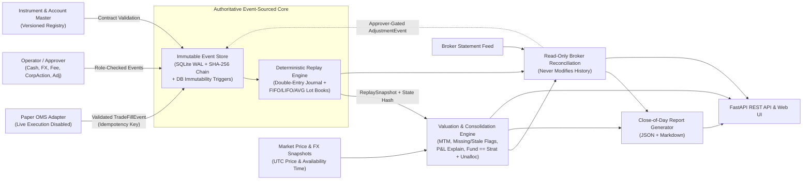

# System Architecture — Multi-Strategy Portfolio Management System

## 1. Component Overview

## 2. Component Boundaries & Responsibilities

| Component | Module Path | Responsibility & Boundary |
|---|---|---|
| Instrument & Account Master | `src/pms/domain/master.py` | Owns canonical `Fund`, `Account`, and `Instrument` definitions; validates currency bindings, strategy bindings, and master references before any event enters the subledger. |
| Double-Entry Subledger & Store | `src/pms/ledger/store.py`, `journal.py` | Persists immutable transaction events with unique `idempotency_key` enforcement, SHA-256 hash chaining, DB-level `UPDATE`/`DELETE` abort triggers, and balanced per-currency journal postings (`sum(debits) == sum(credits)`). |
| Strategy Allocation & Lot Accounting | `src/pms/ledger/lots.py`, `engine.py` | Replays events deterministically to derive cash balances, signed cost basis, open lots (FIFO/LIFO/AVG_COST), position flips, splits, dividends, fees, and a canonical SHA-256 `state_hash`. |
| Mark-to-Market & Consolidation | `src/pms/valuation/pricing.py`, `consolidation.py`, `pnl.py` | Values positions and multi-currency cash against point-in-time snapshots, flags missing/stale marks and missing FX, explains 100% of P&L with zero residual, computes P&L bridges, and proves `Fund == sum(Strategies) + Unallocated Cash`. |
| Paper OMS & Broker Adapters | `src/pms/adapters/paper_oms.py`, `broker_feed.py` | Isolates external execution and broker statement schemas from core accounting logic; enforces `live_order_execution_enabled = false`. |
| Reconciliation & Portfolio UI | `src/pms/reconciliation/`, `src/pms/api.py`, `src/pms/web/index.html` | Runs strictly read-only reconciliation, tracks break lifecycle, enforces `APPROVER` role gating for audited adjustment events, and renders operational dashboards and COD reports. |

## 3. Core Invariants

1. **Double-Entry Balance**: Every event produces a `JournalEntry` where `sum(debits) == sum(credits)` independently for every currency touched.
2. **Deterministic Replay**: Replaying event log `1..N` from scratch always yields bit-for-bit identical positions, lots, cash balances, trial balances, and `state_hash`.
3. **Fund Consolidation**: `Fund NAV == sum(Strategy NAVs) + Unallocated Fund NAV`, and independently `Fund Cash == sum(Strategy Cash) + Unallocated Cash`.
4. **Complete P&L Explainability**: `NAV - Net_Capital_Flows == Realized_PnL + Unrealized_Price_PnL + FX_Translation_PnL + Dividends - Fees + Audited_Adjustments` (`unexplained_residual == 0`).
5. **Unpriced Asset Visibility**: Any open position lacking a fresh market mark is explicitly flagged (`MISSING_MARK` / `STALE_MARK`), carried at cost basis rather than silently zeroed, and surfaced in `unpriced_instruments` and `exceptions`.
6. **Non-Destructive Reconciliation**: Reconciliation never updates or deletes historical events; resolutions append new `APPROVER`-authorized `AdjustmentEvent` records linked by `reconciliation_break_id`.
