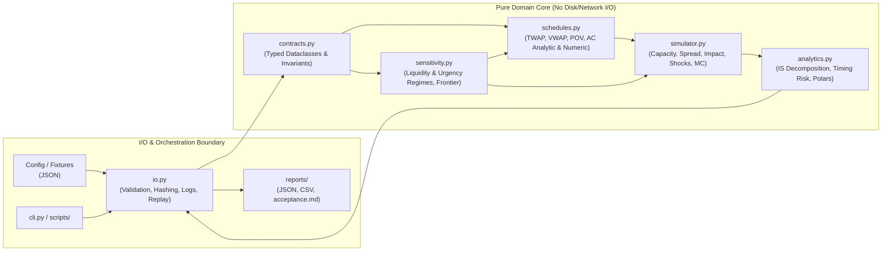

# Architecture — Optimal Execution Research Engine

## 1. System Overview & Layer Boundaries

The engine strictly separates **pure domain mathematics** (schedule optimization, fill simulation, cost analytics, sensitivity sweeps) from **I/O and orchestration** (JSON schema loading, content-addressed run IDs, structured logging, replay manifests, Polars CSV/JSON report emission, and CLI dispatch).

## 2. Module Responsibilities

| Module | Layer | Responsibility |
|---|---|---|
| `src/optimal_execution/contracts.py` | Domain | Immutable typed dataclasses (`ParentOrder`, `MarketProfile`, `ImpactParams`, `ExecutionScenario`, `Schedule`, `FillSlice`, `CostMetrics`, `SimulationDiagnostics`, `SimulationResult`, `MonteCarloSummary`, `SensitivityPoint`, `RunMetadata`), schema version (`1.0.0`), and domain exceptions (`ValidationError`, `UnsupportedScenarioError`, `ScheduleError`). |
| `src/optimal_execution/schedules.py` | Domain | Pure schedule constructors for TWAP, VWAP, POV/participation, closed-form discrete-time Almgren-Chriss (`sinh` trajectory using `asinh`/`expm1` for full numerical stability), and SciPy SLSQP numeric Almgren-Chriss (supporting nonlinear temporary impact and optional hard capacity bounds). |
| `src/optimal_execution/simulator.py` | Domain | Isolated state-transition engine simulating fills under per-slice capacity caps, zero-liquidity halts, optional spillover carryover, spread, permanent impact, temporary impact, exogenous price shocks, and vectorized fixed-seed Monte Carlo diffusion. |
| `src/optimal_execution/analytics.py` | Domain | Exact Perold (1988) implementation shortfall decomposition (execution shortfall + opportunity cost), closed-form analytic expected cost and timing risk, Monte Carlo quantile/VaR/CVaR aggregation, and Polars DataFrame builders. |
| `src/optimal_execution/sensitivity.py` | Domain | Multiplicative liquidity/spread/volatility/impact regime sweeps across urgency ($\lambda$) and strategies, plus Almgren-Chriss efficient frontier tracing. |
| `src/optimal_execution/io.py` | I/O | File loading, SHA-256 canonical config hashing, deterministic `run_id`, JSON structured logging, replay manifest serialization/re-execution, and versioned report output. |
| `src/optimal_execution/cli.py` | I/O | Subcommands (`demo`, `sensitivity`, `compare`, `validate`, `replay`) with explicit non-zero exit codes on invalid or missing inputs. |

## 3. Core Invariants

1. **Order Conservation**: For every schedule and every simulated path,
   $$\sum_{k=0}^{N-1} f_k + R = Q \quad (\text{within } 10^{-6}\text{ shares})$$
   where $f_k \ge 0$ is slice fill, $R \ge 0$ is unfilled residual, and $Q > 0$ is parent order size.
2. **Capacity Safety**: For every slice $k \in \{0, \dots, N-1\}$,
   $$0 \le f_k \le C_k = \min(\rho_{\max} V_k,\; C_{\text{abs}})$$
   In particular, $V_k = 0 \implies C_k = 0 \implies f_k = 0$.
3. **Time Constraints**: All executions occur strictly within the $N$ discrete slices $[0, N)$; remaining inventory $x_k$ is non-negative and monotonically non-increasing.
4. **Exact IS Accounting Identity**: For every simulated path,
   $$IS_{\text{exec}} \equiv C_{\text{spread}} + C_{\text{temp}} + C_{\text{perm}} + C_{\text{timing}} + C_{\text{shock}}$$
   and
   $$IS_{\text{total}} \equiv IS_{\text{exec}} + C_{\text{opp}}, \quad C_{\text{opp}} = s \cdot R \cdot (S_N - S_0)$$
   where $s = +1$ for buy and $s = -1$ for sell.
5. **Reproducibility**: Given identical versioned JSON scenario, strategy configuration, and integer RNG seed, Monte Carlo summaries and pathwise arrays are bit-identical and produce the exact same content-addressed `run_id`.

## 4. Mathematical Model & Trade-Offs

### Price & Impact Dynamics (Almgren & Chriss 2001)
Let $\tau = \Delta t_{\text{min}} / 390$ be slice duration in trading days, $\sigma_\$ = S_0 \sigma_{\text{day}}$ be dollar volatility per $\sqrt{\text{day}}$, $\epsilon = \frac{1}{2} \cdot \text{spread\_bps} \cdot 10^{-4} \cdot S_0$ be half-spread, $\gamma$ be linear permanent impact (`USD / share^2`), and $\eta, \alpha$ be temporary impact parameters.

- **Pre-trade mid-price**: $S_{k}^{\text{pre}} = S_0 + \sum_{j<k} (\sigma_\$ \sqrt{\tau}\xi_j + s\gamma f_j) + \sum_{j \le k} \Delta_{\text{shock}, j}$
- **Execution price**: $\tilde{S}_k = S_{k}^{\text{pre}} + s \left(\epsilon + \eta (f_k / \tau)^\alpha\right)$
- **Post-trade mid-price**: $S_{k}^{\text{post}} = S_{k}^{\text{pre}} + s \gamma f_k + \sigma_\$ \sqrt{\tau}\xi_k$

For linear temporary impact ($\alpha = 1$) and $\tilde{\eta} = \eta - \frac{1}{2}\gamma\tau > 0$:
$$E[IS] = \frac{1}{2}\gamma Q^2 + \epsilon Q + \frac{\tilde{\eta}}{\tau}\sum_{k=0}^{N-1} n_k^2, \qquad \operatorname{Var}[IS] = \sigma_\$^2 \tau \sum_{j=1}^{N-1} x_j^2$$
Minimizing $E[IS] + \lambda \operatorname{Var}[IS]$ yields the exact discrete-time optimal trajectory:
$$x_j = \frac{\sinh(\kappa\tau(N - j))}{\sinh(\kappa\tau N)} Q, \qquad \kappa\tau = 2 \operatorname{arcsinh}\!\left(\frac{\tau}{2}\sqrt{\frac{\lambda\sigma_\$^2}{\tilde{\eta}}}\right)$$

### Key Design Trade-Offs
- **Arithmetic vs. Geometric Brownian Motion**: Arithmetic mid-price diffusion ($\sigma_\$ = S_0 \sigma_{\text{day}}$) matches the exact Almgren-Chriss (2001) closed-form variance, enabling exact oracle cross-checks against Monte Carlo. Trade-off: over extreme multi-week horizons or very high volatility, arithmetic prices could theoretically drift negative (acceptable for intraday/single-day execution research).
- **Deterministic vs. Stochastic Volume Curve**: Modeled market volume per slice is deterministic within a scenario and stressed across regimes in `sensitivity.py`. This keeps capacity constraints deterministic across Monte Carlo price paths and enables vectorized exact MC evaluation.
- **Static vs. Dynamic Closed-Loop Execution**: Schedules are planned upfront with optional spillover carryover when capacity binds (`CapacityPolicy.SPILLOVER`). Adaptive intraday re-optimization conditioned on realized price paths is intentionally deferred as future research.
