# Architecture & Component Boundaries

## 1. High-Level System Architecture

```mermaid
flowchart LR
    subgraph Inputs["Versioned Point-in-Time Inputs"]
        NAV["DailyNavSnapshot"]
        POS["PositionSnapshot"]
        TRD["TradeExecution"]
        CF["CashFlow & FeeAdjustment"]
        MKT["FxRate, Benchmark & Factors"]
    end

    subgraph Adapters["Clean Upstream Adapters (src/pae/adapters/)"]
        TCA_AD["UpstreamTCAAdapter"]
        HFT_AD["HFTFillAdapter"]
        OPT_AD["PortfolioOptimizerTargetAdapter"]
        PL_AD["OptionalPolarsAdapter"]
    end

    subgraph Core["Deterministic Attribution Pipeline (src/pae/engine/)"]
        VAL["Domain Validation & PIT Guard"]
        RET["Return & Aligned Benchmark Engine"]
        CON["Strategy / Instrument / FX Contribution + Carino"]
        BRN["Brinson-Fachler / BHB Sector Engine"]
        FAC["Multi-Factor OLS Engine (Non-Causal)"]
        TCA["Perold Implementation Shortfall Engine"]
        REC["Reconciliation & Residual / Exception Engine"]
    end

    subgraph Ops["Controls, Storage & Delivery"]
        RBAC["RBAC & Dual-Control Approval"]
        STORE["Immutable Versioned Store + Audit Hash Chain (SQLite / Postgres)"]
        API["REST API (Stdlib HTTP / Optional FastAPI)"]
        EXP["Exporters (JSON / MD / CSV / HTML) & SVG Dashboard"]
    end

    Adapters --> Inputs
    Inputs --> VAL --> RET --> CON
    RET --> BRN
    CON --> BRN
    RET --> FAC
    RET --> TCA
    CON --> REC
    BRN --> REC
    FAC --> REC
    TCA --> REC
    REC --> RBAC --> STORE --> API --> EXP
```

## 2. Component Responsibility Matrix

| Component | Module(s) | Responsibility & Boundary |
|---|---|---|
| **Return & benchmark calculation** | `src/pae/domain/`, `src/pae/engine/returns.py` | Owns canonical contracts, validates UTC/currency/ID invariants, computes cash-flow-adjusted daily TWR (Gross vs Net), Modified Dietz cross-check, Carino linking weights, and date/FX-aligned benchmark returns. |
| **Strategy / instrument contribution** | `src/pae/engine/contribution.py` | Decomposes daily position P&L into local price, FX translation, FX interaction, intraday trading, income, and explicit fee drag; links multi-period contributions via Carino weights with complete `position_ids` / `trade_ids` provenance. |
| **Optional Brinson & factor attribution** | `src/pae/engine/brinson.py`, `src/pae/engine/factors.py` | Computes Brinson-Fachler / BHB sector attribution (Carino active-linked) and multi-factor OLS exposure attribution with explicit non-causation disclaimers and safe degradation when benchmark/factor data is missing. |
| **Execution-cost attribution (TCA)** | `src/pae/engine/tca.py`, `src/pae/adapters/contracts.py` | Computes Perold Implementation Shortfall (delay, market impact, opportunity, explicit fees) and VWAP slippage linked to `TradeExecution` IDs; isolates external TCA/HFT/optimizer schemas behind versioned adapter contracts. |
| **Reconciliation & report API** | `src/pae/engine/reconciliation.py`, `src/pae/storage/`, `src/pae/security/`, `src/pae/api/`, `src/pae/web/`, `src/pae/reporting/` | Verifies all return/attribution identities, surfaces explicit residuals and `DataQualityException`s, persists immutable report versions with revision diffs and hash-chained audit logs, enforces RBAC/dual-control approval, and exposes REST API, exporters, and dashboard. |

## 3. Upstream Foundation Audit & IP Boundary

Per [plan.md](../plan.md) Section 2, three related personal/research repositories were cited as conceptual foundations:

1. `Trading-Software/projects/09-transaction-cost-analysis` — Implementation shortfall & execution slippage analytics.
2. `High-Frequency-Trading-Engine` — Low-latency fill & order execution logs.
3. `Quantum-Trading/projects/02-hybrid-quantum-portfolio-optimizer` — Target portfolio weight optimization outputs.

**Boundary Decision (see ADR-004):** Because repository access, licensing, and SAAT background-IP assignment must be confirmed before copying external code, **zero source code was copied** from those repositories. Instead, `src/pae/adapters/contracts.py` implements clean, versioned, tested adapter contracts (`UpstreamTCAAdapter`, `HFTFillAdapter`, `PortfolioOptimizerTargetAdapter`) mapping normalized external dictionaries into canonical PAE domain types.

## 4. Milestone Delivery Summary (M1–M4)

- **M1 — Foundation & design:** Canonical domain contracts (`models.py`), strict validation (`validation.py`), versioned config (`default_config.json`), return/cash-flow/benchmark conventions (`returns.py`), PostgreSQL DDL (`postgres_schema.sql`), ADRs & methodology docs.
- **M2 — Core implementation:** Daily position-level local/FX/trading/income/fee decomposition, Carino multi-period linking, strict Gross-vs-Net separation (`contribution.py`), and daily reconciliation checks.
- **M3 — Integration & validation:** Brinson-Fachler & BHB sector attribution (`brinson.py`), multi-factor OLS regression with non-causation disclosure (`factors.py`), Perold Implementation Shortfall TCA (`tca.py`), upstream adapter contracts (`contracts.py`), and 7 mandatory scenario tests.
- **M4 — Hardening & delivery:** Immutable versioned SQLite store with revision diffing and tamper-evident SHA-256 audit chain, RBAC & dual-control approval service, HTTP/FastAPI APIs, standalone zero-CDN HTML/SVG dashboard, hand-worked portfolio verification tests (`test_hand_worked_portfolios.py`), reproducible scripts, and retained validation/benchmark evidence in `reports/`.
