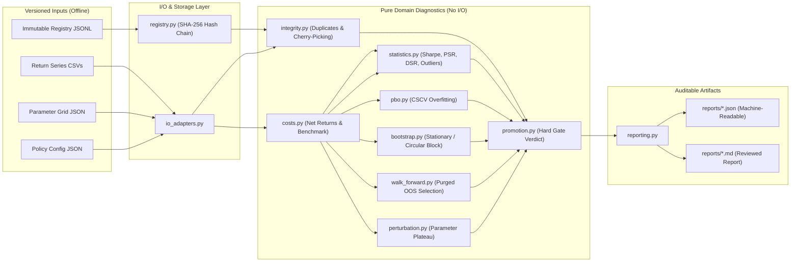

# Architecture — Quantitative Strategy Robustness Lab

## 1. System Overview & Component Boundaries

The Quantitative Strategy Robustness Lab separates **file I/O adapters**, **immutable trial storage**, **pure statistical domain evaluation**, and **governance/reporting** into distinct layers. Pure statistical modules (`costs.py`, `statistics.py`, `pbo.py`, `bootstrap.py`, `walk_forward.py`, `perturbation.py`, `integrity.py`, `promotion.py`) perform zero filesystem or network I/O and operate solely on typed dataclasses and NumPy arrays.

## 2. Core Data Flow

1. **Ingestion & Validation (`io_adapters.py`, `models.py`)**: Load versioned CSV return series, parameter grid manifest, and JSON policy configuration. Reject non-finite values, non-monotonic timestamps, returns `< -1.0`, or unsupported frequencies immediately.
2. **Cryptographic Ledger Verification (`registry.py`)**: Verify the SHA-256 hash chain from genesis (`0000...`), monotonic `sequence_number`, and unique `trial_id` across all `COMPLETED`, `FAILED`, `REJECTED`, and `ABORTED` trials.
3. **Cost & Benchmark Adjustment (`costs.py`)**: Apply per-trial commission, slippage, short-borrow financing, and fixed period costs to compute net-of-cost return series aligned with any supplied benchmark.
4. **Integrity & Cherry-Picking Audit (`integrity.py`)**: Check sequence continuity, SHA-256 return integrity, exact and near-duplicate return series, and planned parameter grid coverage.
5. **Statistical Robustness Suite**:
   - **DSR & PSR (`statistics.py`)**: Adjust Sharpe standard error for skewness, Pearson kurtosis (Mertens 2002), and Bartlett-weighted serial correlation (Lo 2002); deflate against expected maximum null Sharpe using eigenvalue participation-ratio effective trial count $N_{\text{eff}}$.
   - **CSCV PBO (`pbo.py`)**: Partition $T \times N$ return matrix into $S$ equal blocks, evaluate $\binom{S}{S/2}$ splits, compute OOS rank logits, PBO, OOS loss probability, and IS-to-OOS degradation slope.
   - **Block Bootstrap (`bootstrap.py`)**: Stationary or circular block bootstrap with fixed RNG seed for Sharpe, annualized mean return, and max drawdown uncertainty bounds.
   - **Walk-Forward (`walk_forward.py`)**: Expanding or rolling training-only trial selection separated by an explicit purge gap from untouched OOS folds; records exact timestamps per fold.
   - **Perturbation (`perturbation.py`)**: Local neighborhood stability across parameter space measuring positive neighbor fraction, Sharpe cliff ratio, and plateau stability score.
   - **Outlier Diagnostics (`statistics.py`)**: Robust MAD z-scores, excess kurtosis, and 1% winsorized Sharpe sensitivity.
6. **Promotion Gating & Reporting (`promotion.py`, `reporting.py`)**: Evaluate hard policy gates. Force `REJECT` if any required diagnostic is missing or if registry integrity fails. Emit deterministic `run_id`, structured logs, machine-readable JSON, and reviewed Markdown reports.

## 3. Architectural Invariants

- **Append-only trial accounting**: Failed, aborted, and rejected trials are first-class ledger citizens with mandatory `failure_reason` strings and count conservatively toward multiple-testing deflation.
- **Zero lookahead in walk-forward**: Trial selection occurs strictly inside `[train_start, train_end]`, separated from `[test_start, test_end]` by `purge_gap` periods.
- **No silent degradation or silent success**: Missing required evidence sets `evidence_complete = false` and strictly forces `REJECT`. Invalid configs or tampered registries exit non-zero on the CLI.
- **Deterministic reproducibility**: Fixed seeds (`np.random.default_rng(seed)`), canonical JSON hashing, and logical replay equality checks (`compare_reports_logical_equality`).

## 4. Key Trade-Offs

- **JSONL hash-chained ledger vs. relational database**: A flat append-only JSONL ledger has zero infrastructure dependencies, is diffable and portable offline, and provides tamper-evidence via SHA-256 chaining. High-concurrency multi-writer environments would require a transactional database with write-ahead locking (explicitly outside this prototype's scope).
- **Eigenvalue participation ratio for $N_{\text{eff}}$ vs. hierarchical clustering (ONC)**: Participation ratio $N^2 / \text{tr}(C^2)$ is closed-form, smooth, deterministic, and exact on $K$ orthogonal clusters of identical strategies, avoiding clustering initialization sensitivity while remaining interpretable.
- **Asymptotic PSR/DSR vs. nonparametric bootstrap**: DSR relies on asymptotic normality of the Sharpe estimator with higher-moment and autocorrelation adjustments, which can degrade under extreme heavy tails. Pairing DSR with nonparametric block bootstrap and 1% winsorization outlier diagnostics mitigates single-method blind spots.
