# Architecture & Design Notes

## 1. Component & Data-Flow Diagram

```mermaid
flowchart LR
    subgraph Inputs["Versioned Inputs & Config"]
        CFG["config/*.toml / .json"]
        PX["Prices Table (.parquet / .csv)"]
        BRW["Borrow Table (.parquet / .csv)"]
    end

    subgraph Prep["Validation & Contracts"]
        VAL["contracts.py<br/>Schema, Corporate Actions, Hashing"]
    end

    subgraph WF["Walk-Forward Engine (backtest.py)"]
        SPLIT["generate_walk_forward_folds<br/>train_end + embargo < test_start"]
        UNI["universe.py<br/>Point-in-Time Filters (<= train_end)"]
        SEL["cointegration.py<br/>OLS / TLS / Johansen + BH-FDR"]
        SIG["signals.py<br/>Causal Z-Score & State Machine"]
        EXEC["Execution & Ledger<br/>T+1 Fill, Costs, Borrow, Delist Unwind"]
        RECON["verify_trade_position_reconciliation<br/>Exact Replay Invariant"]
    end

    subgraph Eval["Evaluation & Reporting"]
        MET["evaluation.py<br/>Net/Gross, Bootstrap CI, DSR, Stability, Benchmarks"]
        PIPE["pipeline.py / cli.py<br/>Structured Logs & Versioned Reports"]
    end

    CFG --> PIPE
    PX --> VAL
    BRW --> VAL
    VAL --> SPLIT
    SPLIT --> UNI
    UNI --> SEL
    SEL --> SIG
    SIG --> EXEC
    BRW --> EXEC
    EXEC --> RECON
    RECON --> MET
    MET --> PIPE
```

## 2. Module Boundaries

| Layer | Modules | Responsibility | I/O Permitted? |
|---|---|---|---|
| Configuration & Errors | `config.py`, `exceptions.py` | Frozen Pydantic config models, cross-field invariants, SHA-256 config hashing, typed error hierarchy | Config file read only (`load_config`) |
| Data Contracts & Fixtures | `contracts.py`, `fixtures.py` | Polars schema enforcement, missing-bar policies, corporate action split/dividend consistency checks, deterministic synthetic data generation | Parquet/CSV/JSON I/O |
| Point-in-Time Domain Logic | `universe.py`, `cointegration.py`, `signals.py` | Strict `<= train_end` universe filtering, OLS/TLS/Johansen estimation, ADF/Engle-Granger tests, BH-FDR/Bonferroni p-value adjustment, deterministic signal state transitions | **No I/O** (pure functions & dataclasses) |
| Walk-Forward Simulation | `backtest.py` | Fold scheduling with embargo, `T+delay` execution, commission/slippage/borrow accrual, hard borrow locate checks, delisting liquidation, independent trade-to-position reconciliation | **No I/O** |
| Statistical Evaluation | `evaluation.py` | OOS net/gross metrics, Lo/Mertens analytical Sharpe SE, circular block bootstrap CIs, Deflated Sharpe Ratio, fold stability & hedge-ratio drift, equal-weight & zero-cost benchmarks | **No I/O** |
| Orchestration & CLI | `pipeline.py`, `cli.py` | End-to-end execution, multi-config trial sweep ledger, structured JSON logs, runtime metadata, versioned artifact emission (`reports/`) | Report & log I/O |

## 3. Core Invariants

1. **Zero Train/Test Leakage:** Every walk-forward fold enforces `train_end < test_start` with configurable `embargo_days >= 0`. Only rows with `date <= train_end` are passed to `filter_universe` and `select_spreads_on_training_window`, which additionally enforce `max_allowed_date` and raise `LeakageViolationError` on any violation.
2. **Causal Signal Execution:** Signals computed at close `t` enter an execution delay queue (`execution_delay_days >= 1`) and fill at `t + delay`, eliminating same-bar close-to-close lookahead.
3. **Exact Trade-to-Position & Equity Reconciliation:** After every backtest, `verify_trade_position_reconciliation` independently replays all `TradeRecord` cashflows, commissions, slippage, and daily borrow accruals from `initial_capital` and 0 shares, asserting exact agreement with every daily `PositionSnapshot` and `DailyEquityRecord` (raising `ReconciliationError` on any mismatch).
4. **Corporate Action Invariance:** Prices are validated for split-adjustment consistency (`close_adj` vs `close_raw`, `split_factor`, `cash_dividend`), and portfolio accounting operates on total-return adjusted share equivalents so synthetic stock splits leave signals, trades, and OOS returns invariant.
5. **Hard Borrow Constraints:** When `enforce_borrow_availability = true`, unavailable locates block new short spreads (never opening unhedged single legs), force-recall existing spreads if `recall_on_borrow_loss = true`, cap short legs to `max_short_notional` while preserving hedge ratios, or raise `BorrowUnavailableError` in strict mode.
6. **Attempted-Configuration Transparency:** The pipeline records all attempted `sweep_z_entries` configurations with their `config_hash` and computes the Deflated Sharpe Ratio across the full trial count.

## 4. Architecture Decision Records (ADRs)

### ADR-001: Adjusted-Price Total-Return Accounting with Contract-Level Corporate Action Validation

- **Context:** Pairs and basket mean reversion require continuous price ratios across stock splits and cash dividends, while realistic backtests must verify that unadjusted raw price jumps do not create phantom spread signals or PnL spikes.
- **Decision:** Require both `close_adj` (backward split- and dividend-adjusted total-return price) and `close_raw` alongside explicit `split_factor` and `cash_dividend` columns in the canonical price contract. Validate consistency between raw and adjusted returns on split dates inside `contracts.validate_prices`, and account for share positions and fills in adjusted-share units.
- **Consequences:**
  - *Pros:* Split invariance holds to machine precision; unadjusted price feeds with split metadata fail fast with `ContractValidationError`; cash dividends are seamlessly reflected without separate dividend-reinvestment drift.
  - *Trade-offs:* Requires upstream data pipelines to provide consistent `close_adj` and `close_raw`; integer share-lot rounding is deferred outside this research prototype.

### ADR-002: Pure Domain Modules + Independent Ledger Replay Verifier

- **Context:** Backtest accounting bugs (dropped trades, unliquidated delistings, off-by-one cash updates) silently corrupt research conclusions.
- **Decision:** Isolate cointegration estimators (`cointegration.py`) and signal state transitions (`signals.py`) from I/O and execution, and make `verify_trade_position_reconciliation` a mandatory post-condition of every `run_walk_forward_backtest` call.
- **Consequences:**
  - *Pros:* Caught a real delisting fold-end carryover edge case during development (`TECH_DELIST` liquidation); guarantees every reported equity curve reconciles to its immutable trade ledger.
  - *Trade-offs:* Minor CPU overhead (~1 ms per backtest) to replay ledgers, which is negligible relative to econometric testing.
