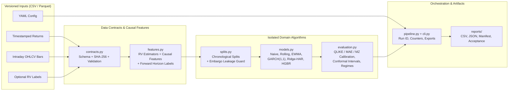

# Architecture — Volatility Forecasting Engine

## 1. Overview and Boundaries

The Volatility Forecasting Engine separates **data validation & causal feature engineering**, **statistical & ML volatility modeling**, **leakage-guarded chronological evaluation**, and **reporting/CLI orchestration** into explicit, testable modules under `src/volatility_forecasting/`:

## 2. Core Data Flow and Invariants

1. **Strict Causality Invariant (No Look-Ahead):**
   - Features at forecast origin $t$ (`rv_1d`, `rv_5d`, `rv_22d`, `vol_*`, `log_rv_*`, `neg_return_1d`, `leverage_5d`, `overnight_gap_sq`, `intraday_bar_coverage`, `parkinson_rv_1d`, `rv_ratio_5_22`) depend exclusively on observations at timestamps $\le t$.
   - Forward horizon-$h$ labels at origin $t$ average realized variance strictly over $(t+1, \dots, t+h)$ and record `label_start_ts_h{h}` and `label_end_ts_h{h}`.
2. **Purge / Embargo Leakage Guard (`splits.py`):**
   - Every chronological split enforces `embargo_steps >= horizon_days`.
   - `assert_no_future_leakage` verifies that `max(train.timestamp) < min(test.timestamp)` and `max(train.label_end_ts_h{h}) < min(test.timestamp)`, raising `FutureLeakageError` on any violation.
3. **Training-Window-Only Fitting:**
   - All preprocessing (`StandardScaler` inside scikit-learn `Pipeline`), Duan smearing factors, GARCH(1,1) QML parameters, conformal interval multipliers (fit on a held-out calibration tail within each training fold), and volatility regime quantile thresholds are fit strictly inside each training fold.
4. **Nonnegativity & Finite Output Contract:**
   - `validate_nonnegative_forecasts` checks every model's variance predictions; any negative, `NaN`, or infinite prediction raises `NegativeForecastError` immediately rather than being clipped silently.
5. **Domain / I/O Isolation:**
   - `features.py`, `models.py`, `splits.py`, `evaluation.py`, and `evaluate_models_chronologically()` operate purely on in-memory Polars DataFrames and NumPy arrays without reading or writing the filesystem.

## 3. Architectural Decision Record — ADR-001

**Title:** Self-contained SciPy QML GARCH(1,1) with optional `arch` adapter, plus multiplicative conformal intervals  
**Status:** Accepted  
**Context:** The engine must run reproducibly in offline or minimal Python environments while supporting standard volatility baselines (rolling historical, EWMA, GARCH(1,1), HAR/ML) and calibrated forecast intervals.  
**Decision:**
- Implement a stationary, variance-normalized Gaussian QML GARCH(1,1) fitter in `models.py` using `scipy.optimize.minimize` (L-BFGS-B with multi-start initialization) and exact closed-form $h$-step average variance forecasts. Expose `backend="arch"` as an optional adapter when `arch` is installed.
- Fit ML models (`RidgeHARModel`, `HGBRVolModel`) on `log(max(rv, variance_floor))` with a training-only Duan smearing correction so forecasts are guaranteed finite, strictly positive, and well-scaled across regimes.
- Construct prediction intervals via finite-sample multiplicative conformal quantiles (`actual / predicted`) fit on an inner calibration tail of each training fold. Multiplicative intervals guarantee lower bounds $\ge 0$ and scale naturally during volatility shocks.
- Use Polars for tabular ingestion, validation, and artifact exports; NumPy/SciPy/scikit-learn for numerical modeling.

**Trade-offs:**
- SciPy QML GARCH(1,1) assumes Gaussian innovations (QML remains consistent under mild misspecification, though fat-tailed Student-$t$ likelihoods are not modeled).
- Multiplicative conformal intervals assume approximate exchangeability of relative residual ratios across splits; abrupt regime shocks can temporarily under-cover until the training/calibration window absorbs shock observations.
- Daily realized variance from sparse intraday bars has discretization noise; missing leading/trailing bars are tracked via `intraday_bar_coverage`, while completely missing sessions fall back to daily close-to-close squared returns.
